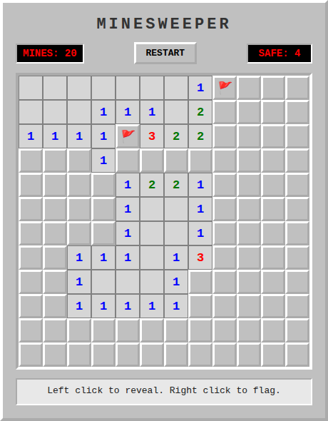
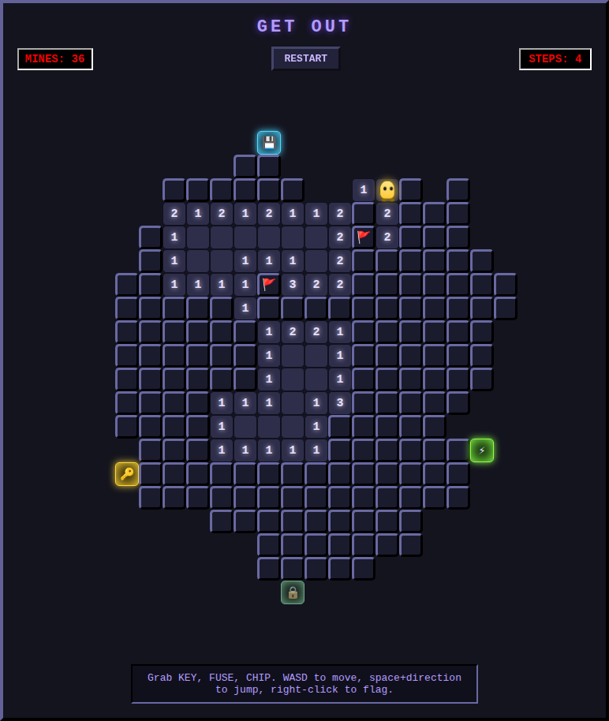

# Don't Step On It

[](https://github.com/Tarmk/Minesweeper/actions/workflows/test.yml)
[](LICENSE)

A Minesweeper that breaks. My entry for [Hack Club Twist](https://twist.hackclub.com/).

**Play it:** https://tarmk.github.io/Minesweeper/ (works on phones too)

<table>
  <tr>
    <td></td>
    <td></td>
  </tr>
  <tr>
    <td align="center">It starts as normal Minesweeper...</td>
    <td align="center">...until it doesn't.</td>
  </tr>
</table>

## The twist

It is a normal 12×12 Minesweeper at first. After five safe clicks something goes wrong: the screen shakes, the colours glitch, and the board grows into a maze that you are now standing inside.

The maze keeps growing while you play, and new mines appear in the new ground. Find the **key**, the **fuse** and the **chip**, then reach the exit without stepping on a mine. The numbers still tell you how many mines are next to each tile, so it is still Minesweeper, just on foot.

## Controls

| | Mouse and keyboard | Phone or tablet |
|---|---|---|
| Reveal (before the glitch) | Left click | Tap |
| Flag | Right click | Turn on **Flag mode**, then tap |
| Move (in the maze) | WASD or arrow keys | On-screen arrows |
| Jump 2 tiles | Space, then a direction (Space again cancels) | **JUMP**, then an arrow |

Flags block your own movement in the maze, so unflag a tile or jump over it.

## Run it

Open `index.html` in a browser. It is plain HTML, CSS and JavaScript with no libraries and no build step. The `main` branch is published to GitHub Pages automatically.

## Tests

Browser tests (Playwright) run on every push, on a desktop and a phone-sized screen: the first click is always safe, flags work with right click and with flag mode, five safe clicks trigger the maze, the player moves with the keyboard and with the d-pad, and the board never scrolls sideways on a phone.

```bash
cd tests
npm install
npx playwright install chromium
npx playwright test
```

The tests have their own `package.json` in `tests/`, so the game itself still has no dependencies.

## License

MIT, see [LICENSE](LICENSE).
